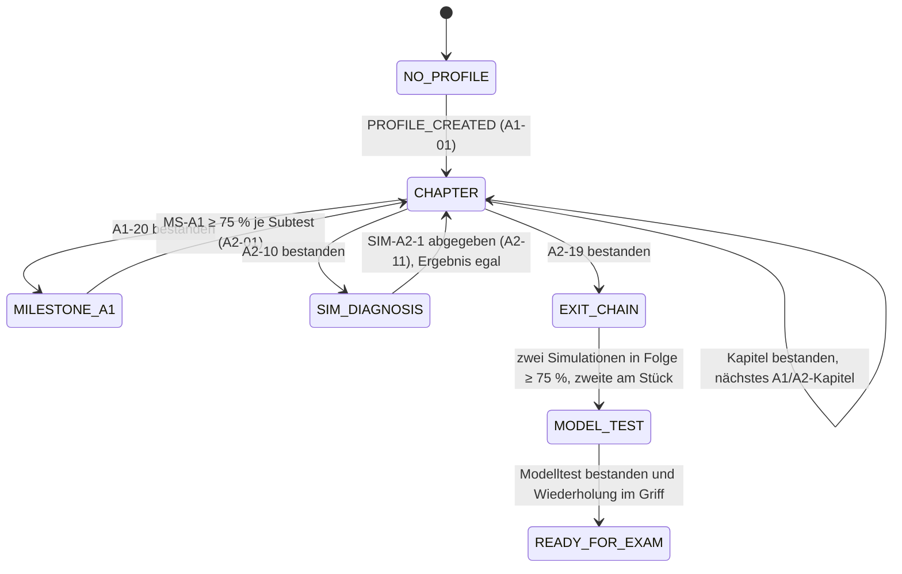
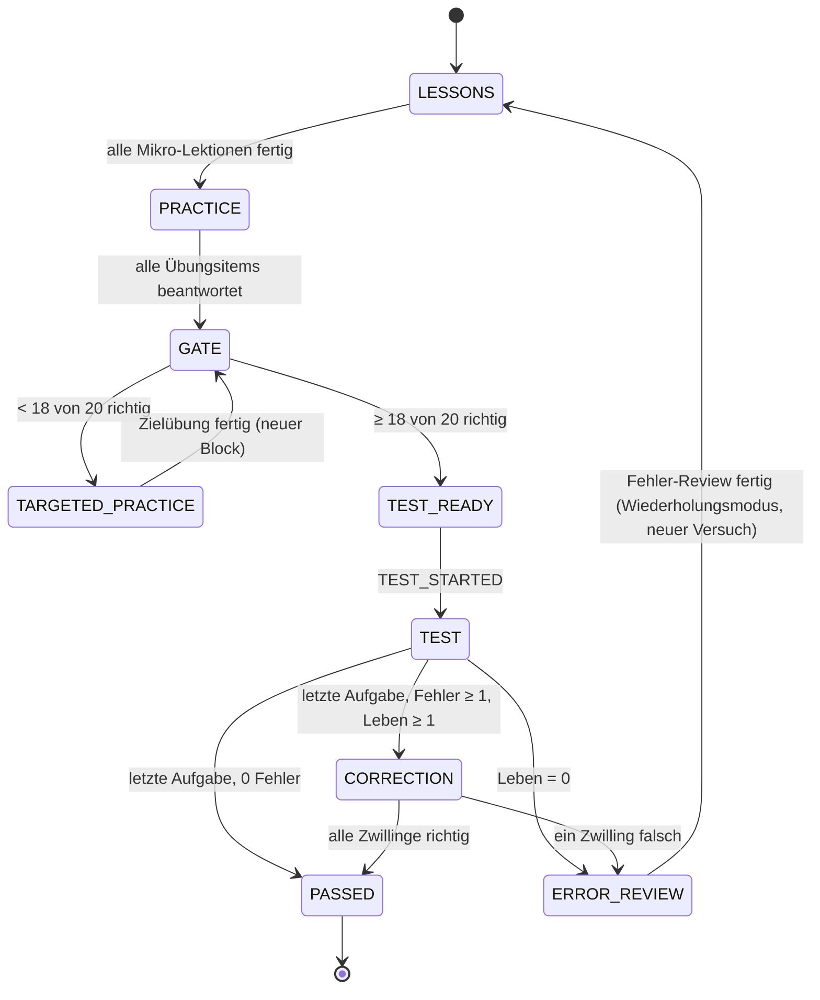
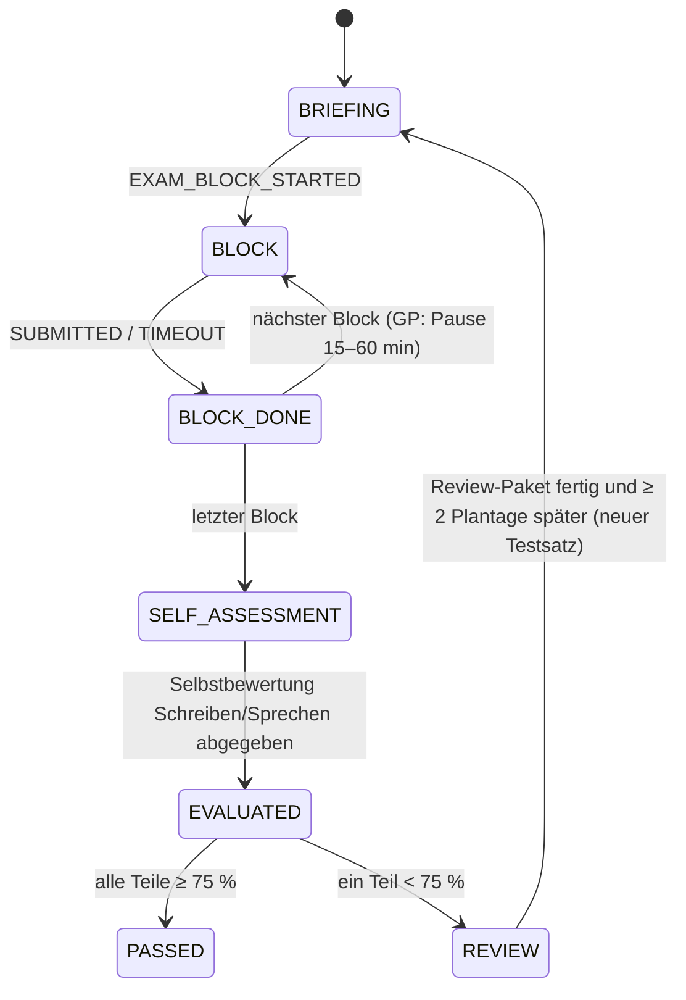
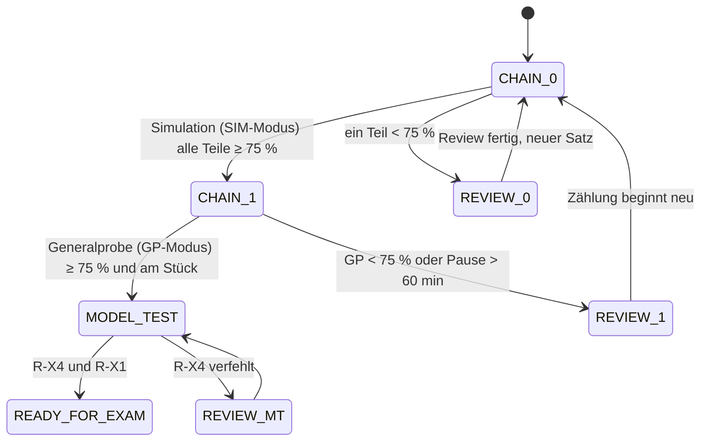

# 04a – Zustandsautomat und normative Spielregeln (Phase 4)

> **Projekt:** „Weg zur A2“ · **Phase:** 4 · **Stand:** 06.11.2026
> **Grundlage:** `00-kurzfassung.md` Abschn. 2, 3, 8 · `03-curriculum.md` Rev. 3R (2.2, 3, 4) · `03a` (Meilensteine) · `02g` (Aufgabentypen, Korrekturregeln) · `prototyp-erkenntnisse.md` (E-P2) · Simulation `04c`
> **Lesehilfe:** Jede Regel hat eine ID (`R-…`), jede Konstante steht in Abschn. 7. Testfälle zu jeder Regel: `04b`. Vorschläge, die du noch bestätigen musst, sind mit **V1–V5** markiert, Auslegungen des Masterprompt-Wortlauts mit **I-1–I-8** (Übersicht `04` Abschn. 1).
> **Verbindlichkeit:** Die Regeln sind so formuliert, dass sie in Phase 6 als reine Funktionen umgesetzt und mit `04b` geprüft werden können. **V1–V5 und I-1–I-8 sind bestätigt (D14, 06.11.2026).** Seit **D16** sind alle Regelentscheidungen in einer austauschbaren **Policy-Schicht** gekapselt (Abschn. 1a); die hier beschriebenen Regeln sind die `defaultPolicy`.

---

## 1. Architektur der Spiellogik

**Ein Zustand, ein Reducer, Zeit als Daten.** Der gesamte Spielstand ist ein serialisierbares Objekt `GameState`. Jede Aktion der Lernenden und jedes Zeitsignal kommt als Event mit Zeitstempel herein. Der Reducer liest **nie** die Systemuhr, sondern nur `event.at`. Warum: Dann sind alle Regeln deterministisch testbar (gleiche Events → gleicher Zustand), Datumswechsel lassen sich im Test simulieren, und ein Export/Import ist einfach ein Snapshot plus Event-Log.

```ts
// Pure core: no I/O, no Date.now(), no randomness without an explicit seed in the event.
type Reducer = (state: GameState, event: GameEvent) => GameState;
// The reducer is built from a rule policy (D16): mechanics in the core, decisions in the policy.
type MakeReducer = (policy: RulePolicy) => Reducer;

// Every event carries wall-clock time and the device offset at that moment.
interface EventBase { id: string; at: string /* ISO-8601 UTC */; tzOffsetMin: number }
```

Python↔TS-Brücke: Das entspricht `functools.reduce(reducer, events, initial_state)` – der Spielstand ist ein Fold über die Event-Liste.

**Orthogonale Teilautomaten** (laufen parallel im selben `GameState`):

| Teilautomat | Zustandsfeld | Abschn. |
|---|---|---|
| Kursfortschritt (Kapitel → Meilensteine → Austritt) | `course.phase` | 4.1 |
| Kapitelversuch (Lernteil → Testreife → Test → Korrektur) | `course.chapter.attempt` | 4.2 |
| Prüfungssimulation (Blöcke, Timer, Auswertung) | `course.exam` | 4.3 |
| Austrittskette + `READY_FOR_EXAM` | `course.exit` | 4.4 |
| Wiederholung (Leitner, Wochenreview) | `review` | 5.5 |
| Tag, Streaks, aktive Zeit | `days`, `streak` | 5.2–5.4 |
| Sperren (Chat, Kopier-Prompt, Sprache) | abgeleitet, kein eigenes Feld | 4.5 |

**Abgeleitete Werte** (nie gespeichert, immer berechnet): `chatLocked`, `plantag`, `dueQueue(today)`, `isExamReady`, Prognose. Warum: Gespeicherte Ableitungen veralten; berechnete können nicht widersprüchlich werden.

---

## 1a. Lose Kopplung: Policy-Schicht (D16)

**Ziel:** Spätere Sonderfälle wie **Spezial-Retries** (z. B. nur den Test wiederholen, zusätzlicher Versuch) oder **Kapitel überspringen** (z. B. Einstufung, Lehrkraft-Freigabe) sollen ohne Umbau von Zustandsmodell, Reducer, Speicherformat oder Export möglich sein. **Die Logik dieser Features wird jetzt nicht entworfen** – es geht nur darum, dass wir uns nicht aussperren.

**Prinzip – Mechanik und Entscheidung trennen.** Der Reducer kennt nur die *Mechanik*: Zustände verwalten, Events buchen, Karten planen, Zeit rechnen. Jede Stelle, an der eine *Regel* entscheidet („darf das Kapitel geöffnet werden?“, „was passiert nach einem gescheiterten Versuch?“, „zählt das Kapitel als erledigt?“), fragt ein `RulePolicy`-Objekt. Die heutigen Regeln (R-F, R-T, R-G, R-L, R-K, R-M, R-X) sind die `defaultPolicy`. Ein neues Feature ist dann eine neue oder erweiterte Policy – der Kern bleibt unverändert (Open/Closed-Prinzip, Strategy Pattern).

Python↔TS-Brücke: `makeReducer(policy)` entspricht `functools.partial(reducer, policy=policy)`; die Policy selbst ist wie ein `typing.Protocol` mit reinen Funktionen.

```ts
// All decision points of the game rules. Every function is pure and gets read-only state.
interface RulePolicy {
  id: string;                       // e.g. 'default'
  version: number;                  // bump on any rule change; stored in GameState.ruleset
  config: RuleConfig;               // all constants of section 7 live here, never hard-coded in the core

  // Access and completion
  canAccessChapter(s: GameState, c: ChapterId): Access;                    // default: R-F1, R-F3
  completionOnPass(s: GameState, c: ChapterId, run: ChapterRun): Completion; // default: { reason: 'passed' }

  // Attempt lifecycle
  testComposition(s: GameState, c: ChapterId): TestSpec;                   // default: R-T1, R-T2
  startLives(s: GameState, c: ChapterId): number;                          // default: R-L1, R-L3
  isTestReady(gate: GateResult): boolean;                                  // default: R-G2 (18/20)
  outcomeAfterTest(run: ChapterRun): 'PASSED' | 'CORRECTION' | 'FAILED';   // default: R-F2, R-L1
  outcomeAfterCorrection(run: ChapterRun): 'PASSED' | 'FAILED';            // default: R-K2
  recoveryAfterFail(s: GameState, run: ChapterRun): RecoveryPlan;          // default: R-K4, R-K5
  bonusForNext(s: GameState, run: ChapterRun): 0 | 1 | 2;                  // default: R-L3

  // Milestones and exit
  examPassed(result: ExamResult): boolean;                                 // default: R-M3 (>= 75 % per part)
  retakeUnlock(s: GameState, exam: ExamRun): RetakeRule;                   // default: R-M4
  isExamReady(s: GameState): boolean;                                      // default: R-X1

  // Overrides (reserved now, logic later)
  acceptOverride(s: GameState, o: OverrideGrant): OverrideDecision;        // default: reject all
}

type Access = { allowed: true } | { allowed: false; reason: string };

// Completion is a record with a reason, not just "passed" – a skipped chapter must be representable.
type Completion = { reason: 'passed' | 'skipped' | 'waived'; at: string; grantId?: string };

// What happens after a failed attempt is data, interpreted by the mechanics.
interface RecoveryPlan {
  errorReview: boolean;                       // default true  (R-K4)
  entry: 'LESSONS' | 'PRACTICE' | 'GATE' | 'TEST_READY';   // default 'LESSONS' (R-K5)
  repeatMode: boolean;                        // default true
  resetLives: boolean;                        // default true  (back to startLives)
  newSelection: boolean;                      // default true  (R-T4)
}

// Generic override grant, e.g. a future chapter skip or an extra retry.
interface OverrideGrant {
  grantId: string;
  kind: 'CHAPTER_SKIP' | 'EXTRA_RETRY' | 'RECOVERY_VARIANT' | (string & {});   // open set
  target: ChapterId | string;
  source: 'placement' | 'teacher' | 'content-pack' | 'debug' | (string & {});
  reason?: string;
  payload?: Record<string, unknown>;
}
type OverrideDecision = { accepted: false; reason: string } | { accepted: true; effects: OverrideEffect[] };
type OverrideEffect =
  | { kind: 'COMPLETE_CHAPTER'; chapterId: ChapterId; completion: Completion }
  | { kind: 'SET_RECOVERY'; chapterId: ChapterId; plan: RecoveryPlan }
  | { kind: 'GRANT_ATTEMPT'; chapterId: ChapterId; plan: RecoveryPlan };
```

**Was jetzt schon im Datenmodell steht (damit spätere Features nichts brechen):**

| Vorkehrung | Wo | Warum |
|---|---|---|
| `course.completed: Record<ChapterId, Completion>` statt einer reinen Liste bestandener Kapitel | Abschn. 2 | ein übersprungenes Kapitel ist darstellbar, ohne das Format zu ändern; Statistik und Austritt können später unterscheiden |
| `state.ruleset: { id, version }` | Abschn. 2 | Export/Import weiß, unter welchen Regeln ein Stand entstand; Migration je Version |
| `state.overrides: OverrideRecord[]` (Grant + Entscheidung + Zeit) | Abschn. 2 | Grants und Ablehnungen sind protokolliert und überleben Export/Import |
| Event `OVERRIDE_GRANTED` | Abschn. 3 | ein Eingang für alle künftigen Sonderwege statt vieler Spezial-Events |
| `RecoveryPlan` als Daten | oben | neue Retry-Varianten sind neue Werte, keine neuen Zustände |
| Konstanten in `policy.config` | Abschn. 7 | Testlänge, Leben, Schwellen pro Policy änderbar |
| Zufall, Uhr, Speicher bleiben Ports bzw. Event-Daten | Abschn. 1 | eine neue Policy erbt Determinismus und Testbarkeit |

**Regeln für die Policy-Schicht**

- **R-PL1** Der Kern trifft keine Regelentscheidung selbst; jede Entscheidungsstelle aus der Schnittstelle oben geht über `policy`. Code-Review-Kriterium in Phase 6: kein `if (lives === 0)`, kein `>= 0.75`, kein `chapterIndex + 1` im Kern außerhalb von `defaultPolicy`.
- **R-PL2** `defaultPolicy` lehnt **jeden** `OVERRIDE_GRANTED` ab (Eintrag in `overrides` mit `accepted: false`, sonst keine Zustandsänderung). Damit bleibt das heutige Verhalten exakt wie in Abschn. 4–5 spezifiziert (D11: kein Überspringen).
- **R-PL3** Effekte einer akzeptierten Override werden **nur** über die Mechanik angewendet (`COMPLETE_CHAPTER`, `SET_RECOVERY`, `GRANT_ATTEMPT`) und laufen durch dieselben Buchungen (Karten, Statistik, Prognose) wie normale Übergänge.
- **R-PL4** Unbekannte `kind`- oder `entry`-Werte werden beim Import/Upload per Schema abgelehnt, nicht stillschweigend ignoriert.
- **R-PL5** Ein importierter Stand mit unbekanntem `ruleset.id` oder höherer `version` wird nur lesbar geöffnet, mit Hinweis; Migrationen laufen je `ruleset.version`.
- **R-PL6** Chat-Sperre, Hörregeln, Zeitlimits in Simulationen und Leitner sind **keine** Policy-Punkte, sondern feste Mechanik (Prüfungsformat, Entscheidung 7, D7) – sie gelten für jede Policy.

**Benannter Zielkonflikt:** Ein Kapitel-Skip widerspricht heute **D11** („kein Kürzen, 100 % Abdeckung“) und R-F1. Die Policy-Schicht macht ihn *technisch möglich*, nicht *erlaubt*. Ein Skip-Feature braucht später eine eigene Entscheidung (z. B. nur nach Einstufungstest, nur für Lehrkräfte, oder übersprungene Kapitel zählen nicht für `isExamReady`).

---

## 2. Zustandsmodell (TypeScript-Skizze für Phase 6)

```ts
type LocalDate = string;                    // 'YYYY-MM-DD' in the device time zone at event time
type ChapterId = `A1-${string}` | `A2-${string}`;
type Discipline = 'lesen' | 'hoeren' | 'schreiben' | 'sprechen' | 'grammatikWortschatz' | 'werte';

interface GameState {
  schemaVersion: number;
  ruleset: { id: string; version: number };   // D16: rules this state was played under
  overrides: OverrideRecord[];               // D16: all grants with decision, never deleted
  profile: { name: string; startDate: LocalDate; pensumMin: 60 | 90 | 105 | 120 } | null;
  course: {
    phase: CoursePhase;
    completed: Record<ChapterId, Completion>; // D16: reason 'passed' | 'skipped' | 'waived'; default policy only 'passed'
    chapter: ChapterRun | null;              // the chapter currently being worked on
    perfectStreak: { current: number; best: number };   // R-E2
    nextChapterBonus: 0 | 1 | 2;             // R-L3 (interpretation I-2)
    exam: ExamRun | null;                    // open simulation attempt
    examHistory: ExamResult[];
    exit: { chain: 0 | 1; modelTestPassed: boolean; readySince: LocalDate | null };
    usedTestSets: Record<string, number>;   // set id -> times used
  };
  review: { cards: Record<string, Card>; weeklyLastDone: LocalDate | null; deferredFrom: LocalDate | null };
  days: Record<LocalDate, DayRecord>;
  streak: { current: number; best: number; freezes: 0 | 1 | 2; lastEvaluated: LocalDate | null; badges: number[] };
  answerStreak: { current: number; best: number };     // R-E1
  clock: { lastEventAt: string; lastLocalDate: LocalDate; skewNotice: boolean };
  session: { anchorDate: LocalDate | null; anchorStartedAt: string | null; lastActivityAt: string | null };
}

type CoursePhase =
  | { kind: 'NO_PROFILE' }
  | { kind: 'CHAPTER'; id: ChapterId }
  | { kind: 'MILESTONE_A1' }                              // MS-A1 incl. review loop
  | { kind: 'SIM_DIAGNOSIS' }                             // SIM-A2-1 (no lock on result)
  | { kind: 'EXIT_CHAIN' }                                // SIM-A2-2 / GP chain, R-X2
  | { kind: 'MODEL_TEST' }
  | { kind: 'READY_FOR_EXAM' };

interface ChapterRun {
  id: ChapterId;
  attemptNo: number;                         // 1, 2, ...
  startLives: number;                        // 3 + bonus (max 5), fixed for all attempts of this chapter
  attempt: AttemptState;
  seenTestItemIds: string[];                 // across attempts, for 'new selection' (R-T4)
  minutesSpent: number;                      // feeds the personal factor k (R-P3)
}

type AttemptState =
  | { kind: 'LESSONS'; repeatMode: boolean; done: string[] }
  | { kind: 'PRACTICE'; answered: number; total: number }
  | { kind: 'GATE'; block: number; items: string[]; correct: number; answered: number }
  | { kind: 'TARGETED_PRACTICE'; goalIds: string[]; done: boolean }
  | { kind: 'TEST_READY' }
  | { kind: 'TEST'; attemptId: string; items: string[]; idx: number; lives: number; wrong: string[]; audioPlays: Record<string, number> }
  | { kind: 'CORRECTION'; attemptId: string; twins: string[]; idx: number; livesLeft: number }
  | { kind: 'ERROR_REVIEW'; cardIds: string[]; done: string[] }
  | { kind: 'PASSED'; perfectFirst: boolean };

interface OverrideRecord { grant: OverrideGrant; at: string; decision: OverrideDecision }

interface ExamRun {
  examId: string; kind: 'MS-A1' | 'SIM-A2-1' | 'SIM-A2-2' | 'GP-A2'; mode: 'SIM' | 'GP';
  setId: string; status: 'BRIEFING' | 'BLOCK' | 'BETWEEN_BLOCKS' | 'SELF_ASSESSMENT' | 'EVALUATED' | 'REVIEW';
  block: number; blockDeadline: string | null;  // wall-clock deadline, R-M2
  pauseStartedAt: string | null;                // GP pause length, R-X3
  answers: Record<string, unknown>; audioResumeUsed: Record<string, boolean>;
  reviewUnlockDate: LocalDate | null; reviewPackageDone: boolean;
}

interface Card {
  id: string; kind: 'vocab' | 'set' | 'grammar' | 'wow' | 'error';
  refId: string;                             // inventory id, item id or learning goal id (stable IDs)
  box: 1 | 2 | 3 | 4 | 5;                    // Fach
  due: LocalDate; mastered: boolean; archived: boolean;
  directions: Direction[]; nextDirection: Direction; lastWrongDirection: Direction | null;
  isNoun: boolean;
}
type Direction = 'recognize' | 'produce' | 'genus';

interface DayRecord {
  activeSec: number;
  dueAtStart: number; answeredDue: number;   // queue bookkeeping for the daily goal (R-S1)
  goalMet: boolean; frozen: boolean; simDeferred: boolean;
}
```

---

## 3. Events

| Event | Nutzlast | Wer löst aus |
|---|---|---|
| `PROFILE_CREATED` | name, pensumMin | Onboarding |
| `PENSUM_CHANGED` | pensumMin | Einstellungen |
| `APP_OPENED` / `TICK` | – (nur `at`) | App-Start, alle 15 s bei Sichtbarkeit |
| `ACTIVITY` | seconds (≤ 15) | Tick mit Interaktion ≤ 90 s oder laufendem Audio |
| `LESSON_COMPLETED` | chapterId, lessonId, introducedRefIds | Lektion |
| `PRACTICE_ANSWERED` | itemId, correct | Übung |
| `GATE_ANSWERED` | itemId, correct | Testreife-Runde |
| `TARGETED_PRACTICE_DONE` | goalIds | Zielübung |
| `TEST_STARTED` | attemptId, itemIds (vorab gezogen, Seed im Event) | Kapiteltest |
| `AUDIO_PLAY_COMPLETED` | attemptId, itemId | Player |
| `TEST_ANSWERED` | attemptId, itemId, correct, checks? | Kapiteltest |
| `CORRECTION_ANSWERED` | attemptId, twinId, correct | Korrekturrunde |
| `ERROR_REVIEW_ANSWERED` | cardId, correct | Fehler-Review |
| `REVIEW_ANSWERED` | cardId, direction, correct | Leitner-Session |
| `WEEKLY_REVIEW_ANSWERED` / `WEEKLY_REVIEW_DONE` | itemId, correct / – | Wochenreview |
| `EXAM_BLOCK_STARTED` | examId, setId, block, mode (`SIM`/`GP`) | Simulation |
| `EXAM_BLOCK_SUBMITTED` / `EXAM_BLOCK_TIMEOUT` | answers | Simulation |
| `SELF_ASSESSMENT_SUBMITTED` | examId, part, rubric | Schreiben/Sprechen |
| `EXAM_EVALUATED` | examId (Punkte werden aus Antworten + Selbstbewertung berechnet) | System |
| `REVIEW_PACKAGE_DONE` | examId | Review nach Meilenstein |
| `MODEL_TEST_RESULT_ENTERED` | lesen, hoeren, wow, schreibenChecklist, sprechenChecklist | Lernende |
| `SPEAKING_PRACTICE_LOGGED` | date | Selbstauskunft (Austrittskriterium 6) |
| `OVERRIDE_GRANTED` | `OverrideGrant` (Abschn. 1a) | reserviert für spätere Sonderwege; `defaultPolicy` lehnt ab (R-PL2) |
| `CHAT_OPENED` / `COPY_PROMPT_USED` | – | nur Protokoll, ändert keinen Spielzustand |
| `EXPORT_DONE`, `IMPORT_APPLIED`, `CONTENT_PACK_LOADED` | – / snapshot / version | Daten |

**Idempotenz:** Jedes Antwort-Event ist über `(attemptId, itemId)` bzw. `(cardId, sessionId)` eindeutig; ein zweites Event mit gleichem Schlüssel wird ignoriert (Doppeltipp, Neuladen während Speicherung).

---

## 4. Automaten

### 4.1 Kursautomat



| Zustand | Event | Guard | Aktion | Folgezustand |
|---|---|---|---|---|
| `NO_PROFILE` | `PROFILE_CREATED` | Name 1–40 Zeichen | `startDate` = lokales Datum von `at`; Kapitel A1-01 mit `startLives = 3` | `CHAPTER(A1-01)` |
| `CHAPTER(c)` | Kapitel `PASSED` | c ∉ {A1-20, A2-10, A2-19} | `completed[c] = policy.completionOnPass(…)`; Bonus nach R-L3; neues `ChapterRun` | `CHAPTER(next(c))` |
| `CHAPTER(A1-20)` | `PASSED` | – | wie oben | `MILESTONE_A1` |
| `MILESTONE_A1` | `EXAM_EVALUATED` | jeder Subtest ≥ 75 % (E3) | Urkunde A1 erzeugbar (R-M6) | `CHAPTER(A2-01)` |
| `MILESTONE_A1` | `EXAM_EVALUATED` | ein Subtest < 75 % | Review-Paket für schwache Subtests (R-M4) | `MILESTONE_A1` (Review-Phase) |
| `CHAPTER(A2-10)` | `PASSED` | – | – | `SIM_DIAGNOSIS` |
| `SIM_DIAGNOSIS` | `EXAM_EVALUATED` | – (Diagnose, keine Sperre) | Fehlerkarten wie immer (R-W3, Pflicht in der Queue); Übungspaket für Teile < 75 % als **freiwillige** Empfehlung | `CHAPTER(A2-11)` |
| `CHAPTER(A2-19)` | `PASSED` | – | `exit.chain = 0` | `EXIT_CHAIN` |
| `EXIT_CHAIN` | `EXAM_EVALUATED` | s. 4.4 | s. 4.4 | `EXIT_CHAIN` / `MODEL_TEST` |
| `MODEL_TEST` | `MODEL_TEST_RESULT_ENTERED` | R-X4 | `exit.modelTestPassed = true` | `READY_FOR_EXAM`, sobald `isExamReady` (R-X1) |

**R-F1 Lineare Freischaltung** (`policy.canAccessChapter`). Kapitel n+1 ist erst zugänglich, wenn Kapitel n bestanden ist. Bereits bestandene Kapitel sind jederzeit **lesbar** (Lektionen, Übungen) – ohne Test, ohne Leben, ohne Einfluss auf den Fortschritt. Warum: Nachschlagen fördert das Lernen und kann nichts überspringen.

**R-F2 Bestanden** heißt: Kapiteltest ohne Fehler **oder** Kapiteltest mit ≥ 1 Leben beendet und alle Zwillinge der Korrekturrunde richtig (Entscheidung 1). Ein anderes „Bestanden“ gibt es nicht.

**R-F3 Sperren an Meilensteinen.** A2-01 erst nach bestandenem MS-A1 (Sperre). A2-11 erst nach **abgegebener** SIM-A2-1 (Diagnose, Ergebnis ohne Sperrwirkung, `03a`).

### 4.2 Kapitelversuch



| Zustand | Event | Guard | Aktion | Folgezustand |
|---|---|---|---|---|
| `LESSONS` | `LESSON_COMPLETED` | letzte offene Lektion | Karten für eingeführte Inhalte anlegen (R-W2) | `PRACTICE` |
| `PRACTICE` | `PRACTICE_ANSWERED` | letztes Item | falsche Items → Fehlerkarte (R-W3) | `GATE` (Block 1) |
| `GATE` | `GATE_ANSWERED` (20.) | richtig ≥ 18 | – | `TEST_READY` |
| `GATE` | `GATE_ANSWERED` (20.) | richtig < 18 | Ziel-Lernziele = Lernziele der falschen Items | `TARGETED_PRACTICE` |
| `TARGETED_PRACTICE` | `TARGETED_PRACTICE_DONE` | – | neuer Gate-Block, andere Items | `GATE` |
| `TEST_READY` | `TEST_STARTED` | kein Wochenreview offen (R-W8); Itemliste erfüllt R-T2/R-T4 | `lives = startLives`; Chat sperren | `TEST` |
| `TEST` | `TEST_ANSWERED` falsch | lives − 1 = 0 | Fehlerkarte; Versuch gescheitert | `ERROR_REVIEW` |
| `TEST` | `TEST_ANSWERED` falsch | lives − 1 ≥ 1 | Fehlerkarte; `wrong += item` | `TEST` (nächstes) / `CORRECTION` (wenn letztes) |
| `TEST` | `TEST_ANSWERED` richtig | letztes Item, `wrong = []` | Karten-Beförderung R-W4 | `PASSED(perfectFirst = attemptNo = 1)` |
| `CORRECTION` | `CORRECTION_ANSWERED` falsch | – | Fehlerkarte; Runde endet sofort | `ERROR_REVIEW` |
| `CORRECTION` | `CORRECTION_ANSWERED` richtig | letzter Zwilling | Chat frei | `PASSED(perfectFirst = false)` |
| `ERROR_REVIEW` | `ERROR_REVIEW_ANSWERED` | alle Fehlerkarten des Versuchs je 1× richtig | `attemptNo += 1`; Plan aus `policy.recoveryAfterFail` anwenden (default: Lives zurück auf `startLives`) | `LESSONS(repeatMode)` (default; allgemein `plan.entry`) |

**Regeln Kapiteltest**

- **R-T1 Länge (V1).** Der Kapiteltest hat **genau 20 bewertete Aufgaben**: je Disziplin 3, die Fokus-Disziplin des Kapitels (`03a`) +2; Prüfungstraining-Kapitel (A1-20, A2-19): Lesen 4, Hören 4, übrige je 3. Dazu kommt **eine Pflicht-Sprechaufnahme**, die kein Leben kostet (R-T7). Begründung und Simulation: `04` Abschn. 2.
- **R-T2 Ziehung.** Aufgaben werden **zufällig, geschichtet** aus dem Test-Pool gezogen (Pool ≥ 60 Items, `03` Q6): erst Disziplin-Quote, innerhalb der Disziplin bevorzugt Lernziele, die noch keine Aufgabe im Test haben; nie zwei Zwillinge desselben Grund-Items im selben Test. Seed und Itemliste stehen im Event `TEST_STARTED` (reproduzierbar).
- **R-T3 Ein Fehler = eine Aufgabe falsch (I-1).** Eine Aufgabe kostet höchstens 1 Leben. Mehrteilige Aufgaben (z. B. Formular mit 3 Feldern) sind falsch, wenn ein Teil falsch ist; deshalb haben Kapiteltest-Aufgaben höchstens 3 Teile (Hinweis an Phase 5).
- **R-T4 Neue Auswahl beim Wiederholen.** Ein neuer Versuch zieht bevorzugt Items, die in früheren Versuchen dieses Kapitels nicht vorkamen (`seenTestItemIds`). Erst wenn der Pool dafür nicht reicht, kommen die am längsten nicht gesehenen zurück.
- **R-T5 Feedback im Test.** Nach jeder Antwort: richtig/falsch, Leben-Anzeige, kurze Erklärung (`de` + Übersetzung im Feedback). Warum: Sofortiges korrigierendes Feedback ist lernwirksam und macht den Lebensverlust nachvollziehbar.
- **R-T6 Hören im Test.** Abspielhäufigkeit exakt wie im Prüfungsformat des Items (A1 2×; A2 Hören 1+2 2×, 3+4 1×). Ein Durchlauf zählt erst, wenn er **bis zum Ende** gespielt wurde (`AUDIO_PLAY_COMPLETED`); ein vom System unterbrochener Durchlauf darf einmal fortgesetzt werden.
- **R-T7 Freie Produktion im Test.** Schreiben frei (ab A1-16, `02g` 3.4): Formale Checks (Anrede, Gruß, Name, Mindestwortzahl) sind hart. Leitpunkte gelten als bearbeitet, wenn der Schlüsselbegriff-Check trifft **oder** die Lernende den Leitpunkt einem eigenen Satz zuordnet (Zuordnung ist selbst eine Prüfungsfertigkeit; verhindert Fehlalarme des Keyword-Checks). Plagiat-Ähnlichkeit > 0,6 → Text muss vor der Abgabe umformuliert werden, kostet kein Leben. Sprechen frei: Aufnahme + Checkliste sind Pflicht, kosten kein Leben (`02g` 3.5); bewertet werden die automatisch korrigierbaren Sprech-Vorstufen.
- **R-T8 Keine Zeitgrenze** im Kapiteltest (außer Hör-Abspielregeln). Zeitgrenzen gelten in Simulationen (R-M2).
- **R-T9 Sprache (V5).** Stimulus und Aufgabe immer Deutsch. Anweisungen in A1-01 bis A1-04 mit einblendbarer Übersetzung (`en`/`tl`), ab A1-05 nur Deutsch (dort werden alle Prüfungsanweisungen eingeführt, `03a`). Übersetzung der Erklärung immer erst im Feedback.

**Regeln Testreife (V2)**

- **R-G1** Die Testreife-Runde ist der letzte Block des Übungsteils: 20 automatisch korrigierbare Items aus dem **Übungs-Pool** (nie aus dem Test-Pool), Disziplin-Mischung wie R-T1. Ohne Leben, Frage-Chat frei.
- **R-G2** Freigabe des Tests ab **18/20** beim ersten Versuch je Item. Darunter: Zielübung zu den Lernzielen der falschen Items, danach ein neuer Block mit anderen Items.
- **R-G3** Die Runde verändert Leitner-Karten nur über Fehler (Fehlerkarte, R-W3); richtige Antworten befördern keine Karten (sonst würde Üben unmittelbar nach Lernen als „Abruf mit Abstand“ zählen).

**Regeln Leben, Korrektur, Wiederholung**

- **R-L1** Jeder Versuch startet mit `startLives` = 3 + Bonus des Kapitels, höchstens 5. Jeder Fehler im Test = −1 Leben. Bei 0 Leben endet der Versuch sofort.
- **R-L2** Leben gibt es nur im Kapiteltest. Korrekturrunde, Testreife, Übungen, Wiederholung und Simulationen haben keine Leben.
- **R-L3 Bonusleben (I-2).** „Perfektes Kapitel“ = **erster** Versuch ohne Fehler. Dann gilt für das nächste Kapitel `bonus = min(2, bonusDiesesKapitels + 1)`, sonst `bonus = 0`. Der Bonus gilt für **alle** Versuche des nächsten Kapitels („Leben zurückgesetzt“ = zurück auf `startLives`). Damit stapeln nur Serien perfekter Kapitel bis 5 Leben.
- **R-K1 Korrekturrunde.** Test mit ≥ 1 Leben und Fehlern → direkt im Anschluss je falscher Aufgabe ein **Zwilling** (gleiches Lernziel, andere Oberfläche), der in diesem Versuch noch nicht vorkam. Reihenfolge zufällig.
- **R-K2** Ein falscher Zwilling beendet die Korrekturrunde sofort → Versuch gescheitert (Entscheidung 1). Alle richtig → bestanden.
- **R-K3** Fehlt ein ungenutzter Zwilling, wird der am längsten nicht gesehene genommen. QA-Hinweis an Phase 5: Test-Pool-Items mit **≥ 2 Zwillingen** (Masterprompt fordert ≥ 1).
- **R-K4 Gescheitert** → Fehler-Review: alle Fehlerkarten dieses Versuchs je einmal richtig (Wiederholung in der Runde, bis richtig). Erst dann beginnt der neue Versuch.
- **R-K5 Komplett wiederholen** heißt: alle Mikro-Lektionen im **Wiederholungsmodus** (Erklärseiten überspringbar, alle Abrufaufgaben Pflicht), Übungsteil, Testreife, neuer Test mit neuer Auswahl (R-T4).
- **R-K6** Ab dem 2. gescheiterten Versuch im selben Kapitel zeigt die App die Lernziele mit den meisten Fehlern und empfiehlt Frage-Chat und ÖIF-Kursraum. Abkürzungen gibt es nicht (D11).

### 4.3 Prüfungssimulation (MS-A1, SIM-A2-1, SIM-A2-2, GP-A2)



- **R-M1 Blöcke und Reihenfolge.** A1: schriftlich (Sprachbausteine, Hören, Hören und antworten, Lesen, Schreiben; 70 min ohne Pause) → WOW (40 min) → Sprechen (simulierte Gruppe). A2: Lesen (40) → Hören (≈ 12, getaktet) → Schreiben (25) → Pause ≥ 15 min → WOW (40) → Sprechen. Zeiten und Hörregeln aus `00-quellen` A/B.
- **R-M2 Timer.** Wanduhr-basiert (`deadline = start + Dauer`). Die Zeit läuft weiter, wenn die App geschlossen wird – wie in der echten Prüfung. Öffnet die Lernende nach Ablauf, wird der Block mit den gespeicherten Antworten abgegeben (`EXAM_BLOCK_TIMEOUT`). Hören: Aufnahme nicht pausierbar; eine Systemunterbrechung erlaubt **eine** Fortsetzung an der Abbruchstelle, im Ergebnis vermerkt.
- **R-M3 Bewertung.** Objektive Teile automatisch, keine Teilpunkte (WOW). Schreiben: regelbasierte Checks + Raster `02g` 3.4 (A2 `[ANNAHME]`, L1) + Selbstbewertung; Sprechen: Checkliste mit voll/halb/null je Teilleistung (A1, Q06) bzw. Checkliste (A2, L2) – als **Selbsteinschätzung** gekennzeichnet. KI-Feedback ist Lernhilfe, kein Kriterium (Entscheidung 5). Bestanden: **jeder** Teil ≥ 75 % (Entscheidung 6, E3).
- **R-M4 Review-Phase.** Nicht bestanden → Review-Paket aus den Fehlern der Teile < 75 % (Fehlerkarten + Übungsitems desselben Formats aus Kapitel-Übungspools, Umfang ≈ 60 min). Neuer Versuch erst, wenn das Paket erledigt ist **und** ≥ 2 Plantage seit der Auswertung vergangen sind (Spacing statt sofortigem Neuversuch).
- **R-M5 Testsätze.** Jeder Versuch nutzt einen ungenutzten Satz (A1: 3 Sätze; A2: SIM 1, SIM 2, GP, R1, R2). Sind alle verbraucht, kommt der am längsten zurückliegende Satz wieder (frühestens 14 Tage nach Erstnutzung), mit Hinweis „bekannter Satz – Ergebnis ist geschönt“ und Meldung an die Content-Produktion.
- **R-M6 Urkunde.** Nach bestandenem MS-A1 und bei `READY_FOR_EXAM`: Urkunde mit Name, Datum, Prozent je Teil; als Bild/PDF speicherbar (`FileOutPort`), kein Drucken im Artifact. Text: „Übungsergebnis im Tool – kein offizielles Zertifikat.“
- **R-M7 Simulation am Wiederholungstag.** Beim Start des **ersten** Blocks einer Simulation werden alle an diesem Tag fälligen und überfälligen Karten auf den Folgetag verschoben (I-6). Die Karten behalten ihr Fach.

### 4.4 Austrittskette und `READY_FOR_EXAM`



- **R-X1 `isExamReady`** (abgeleitet, `03` 4.2): alle 39 Kapitel bestanden ∧ MS-A1 bestanden ∧ `exit.chain` hat zwei Simulationen in Folge ≥ 75 % geliefert, die zweite im GP-Modus ∧ Modelltest bestanden ∧ **keine Karte > 7 Tage überfällig** ∧ alle Fehlerkarten der letzten Simulation mindestens einmal beantwortet. Kriterium 6 (Sprechen mit Menschen, ≥ 6 Einheiten) wird angezeigt, sperrt aber nicht.
- **R-X2 Kette.** Zähler 0 → nächster Versuch im **SIM-Modus** (Blöcke dürfen auf 2 Tage verteilt werden). Zähler 1 → nächster Versuch im **GP-Modus** (alle Blöcke an einem Tag in Prüfungsreihenfolge, Pausen 15–60 min). Ein Fehlschlag setzt auf 0. SIM-A2-1 zählt nie (Diagnose).
- **R-X3 GP „am Stück“.** Überschreitet eine Pause 60 min, wird die GP ausgewertet, zählt aber nicht als zweite Simulation in Folge (`REVIEW_1`). Warum: Durchhalten über ≈ 2,5 h ist Teil der Prüfungsbelastung.
- **R-X4 Modelltest.** Offizieller ÖIF-Modelltest A2 (Link, Q05) am Stück; die Lernende trägt Punkte für Lesen, Hören, WOW ein (je ≥ 75 %) und füllt die Checklisten Schreiben/Sprechen aus (je ≥ 75 % „ja“). Bei Nichterreichen: gezielte Review, danach erneut – bevorzugt mit einem weiteren offiziellen Übungstest (L4), sonst derselbe mit Hinweis „bekannt“.
- **R-X5 Nach `READY_FOR_EXAM`.** Erhaltungsmodus: Leitner läuft weiter, Wochenreview bleibt, weitere Simulationen mit Reserve-Sätzen sind freiwillig. Wird später eine Karte > 7 Tage überfällig, bleibt der Status erreicht, aber die App zeigt „Vor der Anmeldung: Wiederholung nachholen“. Keine Garantie-Formulierung (D11).

### 4.5 Sperren und Prüfungsmodus (abgeleitet)

```ts
// Derived lock: one function, used by chat, copy-prompt button and translation toggles.
const inTestUnit = (s: GameState): boolean =>
  s.course.chapter?.attempt.kind === 'TEST' ||
  s.course.chapter?.attempt.kind === 'CORRECTION' ||
  s.course.exam?.status === 'BLOCK' ||                        // any running simulation block
  (s.course.exam?.mode === 'GP' && s.course.exam?.status === 'BETWEEN_BLOCKS');  // GP pause belongs to the exam

export const chatLocked = inTestUnit;
```

- **R-C1 (Entscheidung 7, I-3).** Frage-Chat und „Frage an eine KI kopieren“ sind gesperrt vom `TEST_STARTED` bis zum Ende der Korrekturrunde sowie in jedem laufenden Simulationsblock und in den Pausen einer Generalprobe (GP-Modus). Im SIM-Modus mit Blöcken an zwei Tagen ist der Chat zwischen den Blöcken frei. Das Feedback nach einzelnen Test-Items öffnet den Chat **nicht** – Test und Korrekturrunde sind eine Einheit. Frei: Lektionen, Übungen, Testreife, Zielübung, Wiederholung, Wochenreview, nach Abschluss von Test/Korrektur und nach jeder Simulationsauswertung.
- **R-C2** Gesperrte Buttons bleiben sichtbar, deaktiviert, mit „Nach dem Test kannst du fragen“.
- **R-C3** Chat- und KI-Antworten erzeugen **keine** Spiel-Events. `TutorPort`/`FeedbackPort` haben nur Lesezugriff auf den Kontext; Leben, Punkte, Karten und Freischaltungen ändern sich nie durch sie.
- **R-C4 Prüfungsmodus (Simulationen):** nur Deutsch, keine Übersetzung, kein Wörterbuch, keine Hinweise; Übersetzungen und Erklärungen erst in der Auswertung.

---

## 5. Normative Regeln: Streaks, Wiederholung, Fortschritt

### 5.1 Erfolgsstreak

- **R-E1 Antwort-Serie.** Zählt aufeinanderfolgende richtige, **automatisch bewertete** Antworten in Lektionen, Übungen, Testreife, Kapiteltest, Korrekturrunde, Leitner und Wochenreview. Nicht gezählt: Simulationen (Bewertung erst am Ende), Selbstbewertungen, die Wiederholung einer gerade falsch beantworteten Karte in derselben Runde. Eine falsche Antwort setzt auf 0. Rekord = Maximum. Bleibt über App-Neustarts erhalten.
- **R-E2 Perfekt-Serie.** Zählt aufeinanderfolgende Kapitel, die im **ersten** Versuch fehlerfrei bestanden wurden (gleiche Definition wie R-L3). Ein nicht perfektes Kapitel setzt auf 0.

### 5.2 Tagesgrenze, aktive Zeit, Plantag

- **R-D1 Lokales Datum.** Jedes Event bekommt das lokale Datum aus `at` + `tzOffsetMin`. Ein Tag endet um 00:00 Ortszeit (I-5).
- **R-D2 Session-Anker (I-5).** Eine zusammenhängende Session (keine Pause > 90 s), die vor Mitternacht beginnt, zählt mit aktiver Zeit und beantworteten Karten **zum Starttag**, solange sie läuft, höchstens 3 h. Warum: Wer um 23:55 die letzten Karten beginnt, soll das Tagesziel nicht durch die Uhr verlieren; „korrekte Mitternachtslogik“ heißt eindeutig, nicht kleinlich.
- **R-D3 Aktive Zeit.** Ein `ACTIVITY`-Tick (15 s) zählt, wenn die App sichtbar ist **und** (Interaktion ≤ 90 s oder Audio läuft oder ein Simulationsblock läuft).
- **R-D4 Plantag** = Kalendertage zwischen `startDate` und heute + 1 (lokale Daten). Kein Enddatum.

### 5.3 Tagesstreak

- **R-S1 Tagesziel (Entscheidung 4).** Ein Tag ist erfüllt, sobald **aktive Zeit ≥ 20 min** UND **alle an diesem Tag fälligen Karten beantwortet** sind (Fälligkeit nach R-W5, verschobene Karten nach R-M7 zählen nicht). Der Streak steigt in diesem Moment um 1 (sofortige Rückmeldung).
- **R-S2 Bewertung vergangener Tage.** Beim ersten Event mit neuem lokalen Datum werden alle Tage zwischen dem letzten erfüllten Tag und heute (exklusiv) geprüft. Anzahl verpasster Tage = m.
- **R-S3 Freeze (Entscheidung 3, I-4).** m ≤ Freezes → je verpasstem Tag ein Freeze, Streak bleibt (die Tage werden als „geschützt“ markiert, zählen aber nicht zum Streak). m > Freezes → Streak = 0, **Freezes bleiben erhalten** (sie würden die Lücke ohnehin nicht schließen).
- **R-S4 Freeze verdienen.** Jedes Mal, wenn der Streak durch einen erfüllten Tag ein Vielfaches von 7 erreicht: +1 Freeze, höchstens 2.
- **R-S5 Badges** bei 7/30/60/90 Tagen; einmal verdient, bleiben sie.
- **R-S6 Heatmap** je Datum: erfüllt · geschützt (Freeze) · Aktivität ohne Ziel · keine Aktivität; Intensität nach aktiven Minuten.
- **R-S7 Darstellung bei Bruch.** Kein „Du hast deinen Streak verloren“-Alarm, keine Push-Schelte. Gezeigt wird: bisheriger Rekord, neuer Start, angesparte Freezes. Warum: Hervorgehobene gebrochene Serien senken die weitere Beteiligung, reparierbare Serien mildern das (Q99, Silverman & Barasch 2023).

### 5.4 Zeitzonen und Uhr

- **R-D5 Zeitzonenwechsel.** Hat sich `tzOffsetMin` seit dem letzten Event geändert und liegen zwischen dem letzten Event und jetzt < 30 h, zählt ein dadurch „übersprungenes“ Datum nicht als verpasst.
- **R-D6 Uhr zurückgestellt.** Liegt `at` mehr als 5 min vor `clock.lastEventAt`, wird `clock.skewNotice` gesetzt; Datumswerte im Zustand werden nie kleiner (`lastLocalDate` bleibt), Aktivität zählt zum `lastLocalDate`. Es gibt keine weitere Anti-Cheat-Logik (lokales Lernspiel ohne Wettbewerb).

### 5.5 Wiederholung – Karten

- **R-W1 Kartenarten** (S2, `03` 2.2): aktive Wörter (`vocab`), Sets (`set`, eine Karte je Set, Reihen-Drill), Grammatik-Items (`grammar`), Werte-Fakten (`wow`), Fehlerkarten (`error`). Passive Einträge bekommen **keine** Karte.
- **R-W2 Anlage.** Karten für Wortschatz, Sets, Grammatik und WOW entstehen bei `LESSON_COMPLETED` der einführenden Lektion in Fach 1 (fällig am Folgetag).
- **R-W3 Fehlerkarten.** Jede falsch beantwortete Aufgabe in Übung, Testreife, Kapiteltest, Korrekturrunde, Simulation und Wochenreview erzeugt eine Fehlerkarte (Fach 1, fällig morgen) für ihr Grund-Item; gibt es sie schon, fällt sie auf Fach 1 zurück. Die Karte zeigt beim Abruf einen **Zwilling**, rotierend. Falsche Leitner-Antworten erzeugen keine zusätzliche Fehlerkarte (die Karte fällt selbst zurück).
- **R-W4 Beförderung durch den Kapiteltest (S2).** Wird ein Inhalt im Kapiteltest richtig beantwortet, rücken die zugehörigen Karten aus Fach 1 in Fach 2 (fällig in 3 Tagen ab Testdatum). Karten in höheren Fächern bleiben unberührt.
- **R-W5 Leitner.** Fächer 1–5 mit Intervallen 1/3/7/14/30 Tagen. Richtig → nächstes Fach, `due = heute + Intervall(neues Fach)`; richtig in Fach 5 → `mastered` (aus der Tages-Queue, bleibt für Wochenreview und Simulationen). Falsch → Fach 1, `due = morgen`, und die Karte kommt **in derselben Runde** am Ende noch einmal (bis richtig, ohne Fachwirkung). Fällig = `due ≤ heute`.
- **R-W6 Reihenfolge der Queue.** Fehlerkarten zuerst; danach die übrigen Karten nach Fälligkeit, im Wechsel der Kartenarten (Interleaving).
- **R-W7 Genus (V4, E-P2).** Keine eigene Genus-Spur. Nomenkarten haben drei Richtungen: *Erkennen* (Wort → Bedeutung, Auswahl), *Produzieren* (Bedeutung → Nomen **mit Artikel**, Artikel als `strictToken`, `02g`), *Genus* (der/die/das, ohne Audio vor der Antwort). Die Richtung rotiert; nach einem Fehler kommt dieselbe Richtung zuerst wieder. Der Abruf in **Fach 5 ist bei Nomen immer „Produzieren“**, damit „gemeistert“ Bedeutung **und** Genus voraussetzt. Genus-Vergleich gegen `genusAt`; `genusDe` gilt als richtig mit Hinweis (D10). Mehraufwand gegenüber S2: 0 Karten.
- **R-W8 Tagesablauf (D7).** Zuerst die fällige Queue vollständig (ohne Minuten-Deckel), dann – falls fällig – Wochenreview, dann neuer Stoff. Ist die Queue länger als 10 min, wird sie in 10-min-Etappen mit Fortschrittsbalken angezeigt; neuer Stoff (Lektionen, Testreife, Test, Simulation) startet erst bei leerer Queue. Ausnahme: der Start eines Simulationsblocks (R-M7).
- **R-W9 Wochenreview.** Fällig ab Plantag 7, 14, 21 … und **bleibt fällig, bis erledigt** (ein verpasster Tag überspringt ihn nicht). Inhalt: ein Block, ausgelegt auf ≈ 30 min, gemischt aus allen bestandenen Kapiteln – Übungsitems in Prüfungsformaten aus den Kapitel-Übungspools plus Karten aus Fach 3–5 und gemeisterte Karten, gewichtet nach Lernzielen mit Fehlern. Erledigt, wenn der Block vollständig beantwortet ist oder 30 aktive Minuten erreicht sind. Falsch → Fehlerkarte. Abschluss mit Wochenrückblick (gelernte Wörter, gemeisterte Karten, Lernstunden).
- **R-W10 Vor der Kapitelwiederholung:** Fehler-Review nach R-K4.
- **R-W11 Lange Pause.** Kein Sondermodus: überfällige Karten bleiben fällig, die Queue wird vollständig abgearbeitet (D7), in Etappen (R-W8). Nur die Anzeige schätzt die Dauer („ca. 35 min“).

### 5.6 Fortschritt und Prognose

- **R-P1 Kapitelpfad** (Map) mit Status je Kapitel: gesperrt · aktuell · bestanden · perfekt; Meilensteine als eigene Stationen; Etappenleiste mit Lernstunden-Anteil (`03` 3.4).
- **R-P2 % je Disziplin** = Anteil erster Antworten richtig über die letzten 100 automatisch bewerteten Items je Disziplin plus letzter Kapiteltest; Schreiben/Sprechen zusätzlich mit Checklisten-Erfüllung (gekennzeichnet).
- **R-P3 Prognose** wie `03` 3.3 (Restaufwand × persönlicher Faktor k ÷ Tempo der letzten 14 Tage). Die Planminuten je Kapitel enthalten die **erwartete Wiederholung aus der Phase-4-Simulation** (`04` Abschn. 2.6). Tatsächliche Wiederholungen fließen über k ein. Anzeige als Spanne ±15 % und „noch ca. N h“; nie „Rückstand“.
- **R-P4 Schwächenanalyse.** Lernziel ist „schwach“, wenn ≥ 2 der letzten 5 Antworten dazu falsch waren; die 5 schwächsten werden mit „Jetzt üben“ angezeigt (Übungsitems, kein Test).

### 5.7 Daten und Persistenz

- **R-D7 Write-through.** Jedes Event wird vor der Anzeige seiner Folgen gespeichert (`StoragePort`, Snapshot + Event-Log seit Snapshot). Neustart = Snapshot laden + Log abspielen.
- **R-D8 Export-Erinnerung** alle 7 Tage und nach jedem Meilenstein (Fortschritt liegt nur lokal).
- **R-D9 Import** ersetzt den Zustand nach einer In-App-Bestätigung (kein `confirm()`); akzeptiert auch das Prototyp-Format (`prototyp-erkenntnisse` Abschn. 0). Danach läuft R-S2 mit dem aktuellen Datum.
- **R-D10 Content-Pack-Update** ist gesperrt, solange Test, Korrekturrunde oder Simulationsblock offen sind. Karten hängen an stabilen IDs; entfernte IDs werden archiviert, nicht gelöscht.
- **R-D11 Ein Schreiber.** Bei zwei offenen Tabs/Fenstern derselben Herkunft schreibt nur eins (Lock über `BroadcastChannel`/`storage`-Event); das andere zeigt „In einem anderen Fenster geöffnet“ und ist schreibgeschützt.

---

## 6. Randfälle (geklärt)

| # | Fall | Regel |
|---|---|---|
| RF-01 | **Abbruch mitten im Test** (App geschlossen, Tab weg, Akku leer) | Versuch bleibt offen und wird beim nächsten Öffnen an der nächsten Aufgabe fortgesetzt: gleiche Itemliste, gleiche Leben, Chat weiter gesperrt. Es gibt **keinen Neustart** des Tests und kein „Aufgeben“ (I-8) – sonst ließen sich schlechte Ziehungen wegklicken. |
| RF-02 | Abbruch in der Korrekturrunde | wie RF-01, Fortsetzung beim nächsten Zwilling. |
| RF-03 | Abbruch während eines Hör-Items | Nicht zu Ende gespielter Durchlauf zählt nicht (R-T6); ein vom System unterbrochener Durchlauf darf einmal fortgesetzt werden. |
| RF-04 | Abbruch im Simulationsblock | Timer läuft weiter (R-M2); nach Ablauf automatische Abgabe der gespeicherten Antworten. |
| RF-05 | **App-Neustart** allgemein | Snapshot + Event-Log (R-D7); der Zustand ist identisch, abgeleitete Werte werden neu berechnet. Streak-Bewertung (R-S2) läuft beim `APP_OPENED`. |
| RF-06 | **Datumswechsel während einer Session** | Session-Anker (R-D2): Zeit und Karten zählen zum Starttag bis Session-Ende, max. 3 h. Danach gilt das neue Datum; dessen Queue wird erst nach Ende des laufenden Blocks berechnet und angezeigt (keine Karten mitten in eine Runde schieben). |
| RF-07 | Datumswechsel während Kapiteltest | Test läuft unverändert weiter (keine Zeitgrenze, Leben unabhängig vom Datum); aktive Zeit nach R-D2. |
| RF-08 | Datumswechsel während Simulationsblock | Block läuft nach Timer weiter; R-M7 (Verschiebung) betrifft nur den Starttag. |
| RF-09 | Zeitzonenwechsel (Reise) | R-D5. |
| RF-10 | Uhr manuell zurückgestellt | R-D6. |
| RF-11 | Doppeltipp / Neuladen während Speicherung | Idempotenz-Schlüssel (Abschn. 3). |
| RF-12 | Mehrere Tabs/Geräte gleichzeitig | R-D11; Geräte nur über Export/Import (kein Sync). |
| RF-13 | localStorage gelöscht oder voll | Start ohne Profil bietet „Fortschritt importieren“ an; Speicherfehler → Hinweis + sofortiger Export-Vorschlag, kein stiller Verlust. |
| RF-14 | Import mit offenem Test | Test bleibt offen und wird fortgesetzt (Gerätewechsel ist erlaubt); Streak-Bewertung nach Import mit heutigem Datum. |
| RF-15 | Content-Pack-Update während Kapitel | R-D10; offene Versuche sind eingefroren (Item-IDs + `contentVersion` im Versuch). |
| RF-16 | Pool für neue Ziehung erschöpft | R-T4 (älteste wieder). Zwilling fehlt: R-K3. |
| RF-17 | Keyword-Check erkennt Leitpunkt nicht | Zuordnung durch die Lernende (R-T7). |
| RF-18 | Pensum geändert | nur Prognose und Tagesvorschlag ändern sich; Tagesziel bleibt 20 min. |
| RF-19 | Lange Pause (Tage/Wochen) | R-W11 + R-S3. |
| RF-20 | Simulation an einem Tag mit fälligen Karten | R-M7 (Verschiebung auf morgen), Tagesziel = 20 min. |
| RF-21 | Wochenreview an einem Simulationstag fällig | Wochenreview hat Vorrang vor neuem Stoff; Simulation darf danach starten (R-W8). |
| RF-22 | Alle Testsätze verbraucht | R-M5. |
| RF-23 | KI nicht erreichbar / ohne Account | Kopier-Prompt + Offline-Hilfe; keine Wirkung auf Regeln (R-C3, Entscheidung 5). |
| RF-24 | Lernende wechselt mitten im Kapitel das Gerät per Export | wie RF-14; Lektionsfortschritt ist Teil des Snapshots. |
| RF-25 | Sprechaufnahme nicht möglich (kein Mikrofon im Artifact) | Audio-Upload (`SpeechInPort`); ohne Datei kann die Pflicht-Aufnahme durch „laut gesprochen + Checkliste“ ersetzt werden (gekennzeichnet). Kostet nie ein Leben. |

---

## 7. Konstanten (`defaultPolicy.config`, D16)

| Name | Wert | Quelle |
|---|---|---|
| `LIVES_BASE` / `LIVES_MAX` / `BONUS_MAX` | 3 / 5 / 2 | Entscheidung 2, Masterprompt 4.3 |
| `TEST_ITEMS` | 20 (3 je Disziplin + 2 Fokus) | V1, `04` 2.5 |
| `POOL_MIN` / `TWINS_MIN_TESTPOOL` | 60 / 2 | `03` Q6 / R-K3 |
| `GATE_ITEMS` / `GATE_MIN_CORRECT` | 20 / 18 | V2 |
| `LEITNER_INTERVALS_DAYS` | [1, 3, 7, 14, 30] | Masterprompt 4.8 |
| `STREAK_GOAL_MIN` | 20 | Entscheidung 4 |
| `FREEZE_EVERY` / `FREEZE_MAX` | 7 / 2 | Entscheidung 3 |
| `BADGES` | [7, 30, 60, 90] | Masterprompt 4.7 |
| `TICK_SEC` / `IDLE_SEC` | 15 / 90 | R-D3 |
| `SESSION_ANCHOR_MAX_H` | 3 | R-D2 |
| `TZ_TOLERANCE_H` / `CLOCK_SKEW_MIN` | 30 / 5 | R-D5 / R-D6 |
| `WEEKLY_EVERY_DAYS` / `WEEKLY_MIN` | 7 / 30 | `03` 3.1 |
| `QUEUE_CHUNK_MIN` | 10 | R-W8 |
| `PASS_SHARE` | 0,75 je Teil | Entscheidung 6, E3 |
| `REVIEW_MIN_DAYS` / `REVIEW_PACKAGE_MIN` | 2 / ≈ 60 | R-M4 |
| `GP_PAUSE_MIN` / `GP_PAUSE_MAX` | 15 / 60 min | Q02 § 14, R-X3 |
| `SET_REUSE_MIN_DAYS` | 14 | R-M5 |
| `EXIT_MAX_OVERDUE_DAYS` | 7 | `03` 4.2 |
| `K_MIN` / `K_MAX` / `TEMPO_WINDOW_DAYS` | 0,6 / 2,0 / 14 | `03` 3.3 |
| `EXPORT_REMINDER_DAYS` | 7 | R-D8 |
| `WEAK_GOAL` | ≥ 2 von 5 falsch | R-P4 |
